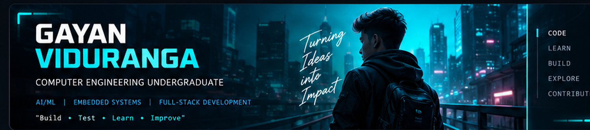

 <div align="center">

  

  <h1>GAYAN VIDURANGA</h1>

  <h3>Computer Engineering Undergraduate · Software Developer</h3>

  <p>
    
  </p>

  <p>
    <a href="https://github.com/gayanviduranga95">
      
    </a>
    <a href="https://portfolio-blond-five-47.vercel.app/">
      
    </a>
    
  </p>

  <p>
    <i>Turning curiosity into code and ideas into practical solutions.</i>
  </p>

</div>

---

## `01 // ABOUT ME`

```yaml
name: Gayan Viduranga
education: Computer Engineering Undergraduate
university: University of Ruhuna
interests:
  - Artificial Intelligence & Machine Learning
  - Embedded Systems & IoT
  - Full-Stack Development
  - Backend Engineering
  - Data Structures & Algorithms
philosophy: "Build. Test. Learn. Improve."
```

- 🎓 Studying Computer Engineering at the University of Ruhuna.
- 🤖 Exploring AI/ML, intelligent agents, and practical automation.
- 🔌 Interested in embedded systems, IoT, and hardware-software integration.
- 💻 Developing web applications, backend services, and database-driven systems.
- 🧠 Strengthening problem-solving skills through algorithms and competitive programming.
- 🚀 Focused on building practical projects and growing as an engineer.

## `02 // TECHNOLOGY STACK`

<div align="center">

### Languages


### Frontend Development


### Backend & Databases


### Tools & Environment


</div>

<p align="center">
  
  
  
  
</p>

## `03 // FEATURED PROJECTS`

<div align="center">

<a href="https://github.com/gayanviduranga95/Learn-Craft">
  
</a>

</div>

<table>
  <tr>
    <td width="50%" valign="top">

### 📚 LearnCraft

A learning management system focused on structured learning workflows and role-based access.

**Technologies:** React · Node.js · Express · MongoDB

[Explore repositories →](https://github.com/gayanviduranga95?tab=repositories)

    </td>
    <td width="50%" valign="top">

### 📱 QR Attendance System

A digital attendance platform integrating a Next.js frontend with a Spring Boot backend.

**Technologies:** Next.js · TypeScript · Spring Boot

[Explore repositories →](https://github.com/gayanviduranga95?tab=repositories)

    </td>
  </tr>
  <tr>
    <td width="50%" valign="top">

### 🌱 Vee Market

A farmer-focused marketplace project with a modern web interface and backend services.

**Technologies:** Java · Spring Boot · PostgreSQL

[View repository →](https://github.com/gayanviduranga95/Vee-market)

    </td>
    <td width="50%" valign="top">

### 🤖 MedoraAI

An AI-assisted healthcare concept exploring goal-driven workflows and multi-agent systems.

**Technologies:** Python · Agentic AI · LangGraph

[Explore repositories →](https://github.com/gayanviduranga95?tab=repositories)

    </td>
  </tr>
</table>

<p align="center">
  <i>Interested in projects that connect software, intelligent systems, and real-world problems.</i>
</p>

> **Before publishing:** Replace generic repository links with each project's exact URL. Verify the technologies shown against the current code in each repository.

## `04 // GITHUB ANALYTICS`

<div align="center">


</div>

## `05 // CONTRIBUTION MATRIX`

<div align="center">

<picture>
  <source media="(prefers-color-scheme: dark)" srcset="https://raw.githubusercontent.com/gayanviduranga95/gayanviduranga95/output/github-contribution-grid-snake-dark.svg"/>
  <source media="(prefers-color-scheme: light)" srcset="https://raw.githubusercontent.com/gayanviduranga95/gayanviduranga95/output/github-contribution-grid-snake.svg"/>
  
</picture>

</div>

## `06 // CURRENT MISSION`

- [ ] Build more industry-style software projects.
- [ ] Strengthen Java, Spring Boot, Python, SQL, and system design.
- [ ] Explore AI/ML through practical prototypes and experiments.
- [ ] Develop embedded systems and IoT projects.
- [ ] Improve algorithmic thinking and competitive programming.
- [ ] Document projects clearly and keep learning in public.

## `07 // CONNECT`

<div align="center">

<a href="https://github.com/gayanviduranga95">
  
</a>
<a href="https://portfolio-blond-five-47.vercel.app/">
  
</a>

<br/><br/>


<h3>⚡ SYSTEM MESSAGE: KEEP BUILDING ⚡</h3>

<p><i>Learn continuously. Build consistently. Make an impact.</i></p>

</div>
